# Práctica: Instalación y administración de Apache2 en Ubuntu 24.04

| | |
|---|---|
| **Alumno** | Nabil Aisatin |
| **Ciclo** | Sistemas Microinformáticos y Redes (SMR) |
| **Módulo** | Aplicaciones Web |
| **Curso** | 2026/2027 |
| **Fecha** | Octubre de 2026 |
| **Servidor** | Ubuntu Server 24.04.5 LTS (máquina virtual, usuario `smr-web`, IP `192.168.56.17`) |
| **Equipo cliente** | Linux Mint (navegador Firefox) |

---

## Índice

1. [Preparación del sistema](#1-preparación-del-sistema)
2. [Instalación de Apache](#2-instalación-de-apache)
3. [Comprobación del funcionamiento](#3-comprobación-del-funcionamiento)
4. [Comandos principales de administración](#4-comandos-principales-de-administración)
5. [Ficheros y directorios importantes](#5-ficheros-y-directorios-importantes)
6. [Modificaciones típicas del servicio](#6-modificaciones-típicas-del-servicio)
7. [Módulos de Apache](#7-módulos-de-apache)
8. [Varios sitios en un mismo servidor (Virtual Hosts)](#8-varios-sitios-en-un-mismo-servidor-virtual-hosts)
9. [Permisos y propietarios](#9-permisos-y-propietarios)
10. [Tabla de fallos encontrados](#10-tabla-de-fallos-encontrados)
11. [Conclusiones](#11-conclusiones)

---

## 1. Preparación del sistema

Antes de instalar nada conviene tener el sistema al día. `apt update` descarga la lista de paquetes disponibles (no instala nada) y `apt upgrade` instala las versiones nuevas de lo que ya tengo. Así evito problemas de dependencias antiguas.

```bash
sudo apt update
sudo apt upgrade -y
```

Compruebo la versión del sistema operativo con `lsb_release -a`, que muestra distribución, versión y nombre en clave:

```bash
lsb_release -a
```

Salida:

```text
No LSB modules are available.
Distributor ID: Ubuntu
Description:    Ubuntu 24.04.5 LTS
Release:        24.04
Codename:       noble
```

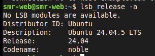

**Explicación:** el sistema es Ubuntu 24.04.5 LTS (nombre en clave *noble*). LTS significa *Long Term Support*: tiene soporte durante muchos años, por eso se usa en servidores. El mensaje «No LSB modules are available» es normal y no es un error.

---

## 2. Instalación de Apache

```bash
sudo apt install apache2 -y
```

Compruebo la versión instalada:

```bash
apache2 -v
```

Salida (en mi caso, Apache 2.4.58, como se ve también en las cabeceras del apartado 6):

```text
Server version: Apache/2.4.58 (Ubuntu)
```

**Explicación:** `apt install apache2` descarga e instala el servidor web y lo deja arrancado y habilitado. `apache2 -v` solo muestra la versión, sirve para confirmar que el programa existe y funciona.

### ❓ ¿Qué paquetes adicionales se han instalado como dependencias?

Al instalar `apache2`, apt instala también automáticamente otros paquetes que Apache necesita para funcionar. En Ubuntu 24.04 son los siguientes (comparar con la salida de apt de mi máquina, ya que puede variar según lo que ya tuviera instalado):

| Paquete | Para qué sirve |
|---|---|
| `apache2-bin` | Los programas ejecutables de Apache (el binario `apache2` real) |
| `apache2-data` | Ficheros de datos: página por defecto, iconos, páginas de error |
| `apache2-utils` | Herramientas auxiliares (`ab`, `htpasswd`, etc.) |
| `libapr1t64` y `libaprutil1t64` | Librerías APR (*Apache Portable Runtime*) que dan a Apache funciones comunes del sistema |
| `libaprutil1-dbd-sqlite3` y `libaprutil1-ldap` | Soporte de APR para bases de datos SQLite y LDAP |
| `liblua5.4-0` | Librería Lua, usada por el módulo `mod_lua` |
| `ssl-cert` | Certificado autofirmado de prueba, útil para HTTPS |

**Explicación:** Apache está dividido en varios paquetes (ejecutable, datos, utilidades, librerías) para que se instale solo lo necesario y se puedan actualizar por separado. apt resuelve esto solo, por eso no tengo que instalarlos a mano.

---

## 3. Comprobación del funcionamiento

### 3.1. Estado del servicio

```bash
sudo systemctl status apache2
```


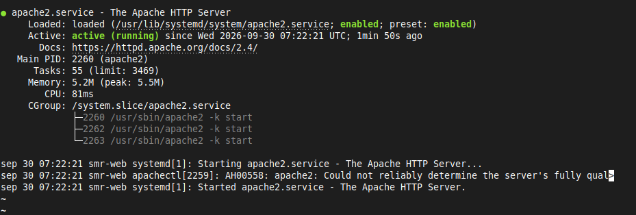

**Explicación:** se ve `Loaded: ... enabled` (arranca solo con el sistema) y `Active: active (running)` (está funcionando ahora). Aparecen varios procesos `apache2 -k start`: uno principal y varios hijos que atienden las peticiones. También sale el aviso `AH00558: Could not reliably determine the server's fully qualified domain name`; no es un error grave, se soluciona en el apartado 6.3.

### 3.2. Puertos en escucha

```bash
sudo ss -tulpn | grep apache2
```

Salida esperada:

```text
tcp   LISTEN  0  511  *:80   *:*   users:(("apache2",pid=...,fd=4),...)
```

**Explicación:** `ss` muestra los sockets de red. Las opciones son: `-t` TCP, `-u` UDP, `-l` solo los que están escuchando, `-p` el proceso dueño y `-n` números en vez de nombres. Con `grep apache2` filtro solo lo de Apache. Veo que escucha en el **puerto 80** (HTTP).

### 3.3. Prueba desde el terminal y desde el navegador

```bash
curl -I http://localhost
```

Salida esperada:

```text
HTTP/1.1 200 OK
Server: Apache/2.4.58 (Ubuntu)
Content-Type: text/html
```

`curl -I` pide solo las cabeceras. El código **200 OK** significa que el servidor respondió correctamente.

Desde el navegador de otro equipo (mi Linux Mint) entro a `http://192.168.56.17` y aparece la página por defecto:

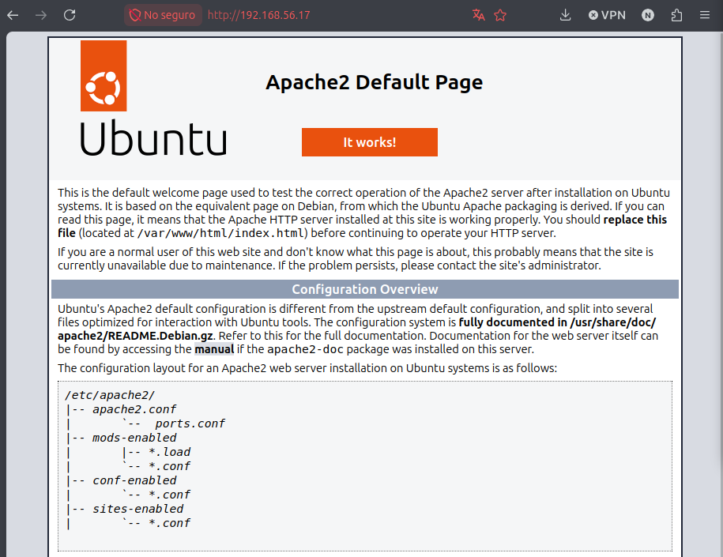

**Explicación:** la página «Apache2 Default Page – It works!» confirma que el servidor es accesible desde la red, no solo desde dentro de la máquina.


### 3.4. Firewall

```bash
sudo ufw status
sudo ufw allow 'Apache'
```

**Explicación:** `ufw status` dice si el cortafuegos está activo. `ufw allow 'Apache'` abre el puerto 80 usando un perfil ya definido por el paquete de Apache. Si UFW está inactivo (`Status: inactive`) no bloquea nada.

### ❓ ¿Qué diferencia hay entre los perfiles Apache, Apache Full y Apache Secure?

| Perfil | Puertos que abre | Uso |
|---|---|---|
| **Apache** | 80/tcp | Solo HTTP (sin cifrar) |
| **Apache Secure** | 443/tcp | Solo HTTPS (cifrado) |
| **Apache Full** | 80/tcp y 443/tcp | HTTP y HTTPS a la vez |

Se puede ver con `sudo ufw app info 'Apache Full'`.

---

## 4. Comandos principales de administración

Probé cada comando y esto es lo que hace cada uno:

| Comando | Función | Explicación |
|---|---|---|
| `sudo systemctl start apache2` | Inicia el servicio | Arranca Apache si está parado |
| `sudo systemctl stop apache2` | Detiene el servicio | Lo apaga; las webs dejan de responder |
| `sudo systemctl restart apache2` | Reinicia (corta conexiones) | Hace stop + start; los usuarios conectados pierden la conexión |
| `sudo systemctl reload apache2` | Recarga la configuración sin cortar conexiones | Lee los ficheros de nuevo sin apagar el servidor |
| `sudo systemctl enable apache2` | Arranque automático | Apache se inicia solo al encender la máquina |
| `sudo systemctl disable apache2` | Desactiva el arranque automático | Habrá que iniciarlo a mano tras cada reinicio |
| `apache2ctl configtest` | Comprueba la sintaxis | Dice `Syntax OK` si no hay errores en la configuración |
| `apache2ctl -S` | Muestra los virtual hosts cargados | Lista sitios, puertos y ficheros de configuración |
| `apache2ctl -M` | Lista los módulos cargados | Muestra qué módulos están activos |
| `a2enmod` / `a2dismod` | Activa / desactiva módulos | Crea o borra el enlace en `mods-enabled` |
| `a2ensite` / `a2dissite` | Activa / desactiva sitios | Crea o borra el enlace en `sites-enabled` |
| `a2enconf` / `a2disconf` | Activa / desactiva fragmentos de configuración | Crea o borra el enlace en `conf-enabled` |

Comandos probados en orden:

```bash
sudo systemctl stop apache2
sudo systemctl start apache2
sudo systemctl restart apache2
sudo systemctl reload apache2
sudo systemctl enable apache2
sudo systemctl disable apache2
sudo systemctl enable apache2      # lo vuelvo a habilitar
apache2ctl configtest
apache2ctl -S
apache2ctl -M
```

> **Importante:** si dejo Apache parado o con `disable`, el navegador dará «No se puede conectar» tras reiniciar la máquina. Es lo que me pasó (ver [apartado 10](#10-tabla-de-fallos-encontrados)). Por eso termino siempre con `sudo systemctl enable apache2` y `sudo systemctl start apache2`.

### ❓ ¿Cuándo conviene usar `reload` en lugar de `restart`?

`reload` conviene usarlo cuando **solo he cambiado la configuración** (un virtual host, un módulo, un `ServerName`) y el servidor está en producción: Apache vuelve a leer los ficheros con el método *graceful*, termina las peticiones en curso con la configuración vieja y las nuevas ya usan la nueva, **sin cortar a nadie**. `restart` apaga y vuelve a encender, así que se pierden las conexiones abiertas; hay que usarlo cuando `reload` no basta (por ejemplo, al activar o desactivar módulos, o cuando el servicio está colgado).

---

## 5. Ficheros y directorios importantes

```bash
ls -l /etc/apache2/
```

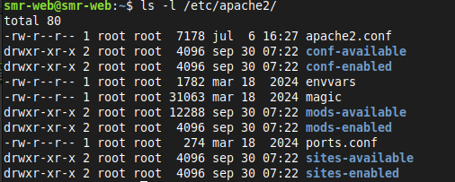

### Tabla de ficheros y directorios

| Ruta | Descripción |
|---|---|
| `/etc/apache2/apache2.conf` | Fichero de configuración **principal**. Carga al resto (`ports.conf`, `mods-enabled`, `conf-enabled`, `sites-enabled`) |
| `/etc/apache2/ports.conf` | Indica en qué **puertos escucha** Apache (`Listen 80`, y `443` si hay SSL) |
| `/etc/apache2/sites-available/` | Configuración de todos los sitios **definidos**, estén o no activos |
| `/etc/apache2/sites-enabled/` | Sitios **activos**. Son enlaces simbólicos a `sites-available` |
| `/etc/apache2/mods-available/` y `mods-enabled/` | Módulos disponibles (`.load` y `.conf`) y módulos activos |
| `/etc/apache2/conf-available/` y `conf-enabled/` | Fragmentos de configuración disponibles y activos |
| `/etc/apache2/envvars` | Variables de entorno: usuario y grupo con el que se ejecuta Apache (`www-data`), carpeta de logs, etc. |
| `/etc/apache2/magic` | Reglas para detectar el tipo de un fichero por su contenido (usado por `mod_mime_magic`) |
| `/var/www/html/` | Directorio raíz por defecto (*DocumentRoot*): aquí está la página web |
| `/var/log/apache2/access.log` | Registro de **accesos**: quién pidió qué y cuándo |
| `/var/log/apache2/error.log` | Registro de **errores**: sirve para diagnosticar fallos |

### Comprobación de los enlaces simbólicos

```bash
ls -l /etc/apache2/sites-enabled/
```


Salida:

```text
lrwxrwxrwx 1 root root 35 sep 30 07:22 000-default.conf -> ../sites-available/000-default.conf
```

**Explicación:** la `l` del principio de `lrwxrwxrwx` indica que es un **enlace simbólico** y la flecha `->` muestra a qué fichero apunta: `../sites-available/000-default.conf`.

### ❓ ¿Por qué Apache usa enlaces simbólicos entre `*-available` y `*-enabled`?

Porque así se puede **activar o desactivar** un sitio, módulo o configuración sin borrar ni copiar el fichero real. El fichero original siempre está en `*-available`; para activarlo (`a2ensite`) se crea un enlace en `*-enabled`, y para desactivarlo (`a2dissite`) solo se borra el enlace, y el fichero original sigue intacto. Ventajas:

- No se pierde la configuración al desactivar algo.
- No hay dos copias que puedan quedar distintas (el enlace apunta siempre al original).
- Es rápido, ordenado y seguro: Apache solo lee `*-enabled`.

---

## 6. Modificaciones típicas del servicio

Antes de tocar nada hago una **copia de seguridad** del fichero principal:

```bash
sudo cp /etc/apache2/apache2.conf /etc/apache2/apache2.conf.bak
```

**Explicación:** si me equivoco, puedo volver atrás copiando el `.bak` encima del original.

### 6.1. Cambiar la página de inicio

```bash
echo "<h1>Servidor de Nabil Aisatin</h1>" | sudo tee /var/www/html/index.html
```

📸 **Captura: nueva página de inicio**


**Explicación:** `echo` escribe el texto HTML y `tee` lo guarda en el fichero con permisos de administrador (con `>` normal no funcionaría porque la redirección la hace mi usuario, no `sudo`). Ahora `/var/www/html/index.html` es mi página en lugar de la de Ubuntu.

### 6.2. Cambiar el puerto de escucha (80 → 8080) y restaurarlo

Edito los dos ficheros:

```bash
sudo nano /etc/apache2/ports.conf
sudo nano /etc/apache2/sites-available/000-default.conf
```

Cambios:

| Fichero | Antes | Después |
|---|---|---|
| `ports.conf` | `Listen 80` | `Listen 8080` |
| `000-default.conf` | `<VirtualHost *:80>` | `<VirtualHost *:8080>` |

Compruebo y aplico:

```bash
sudo apache2ctl configtest
sudo systemctl reload apache2
curl -I http://localhost:8080
```

📸 **Capturas: edición, configtest, reload y estado**

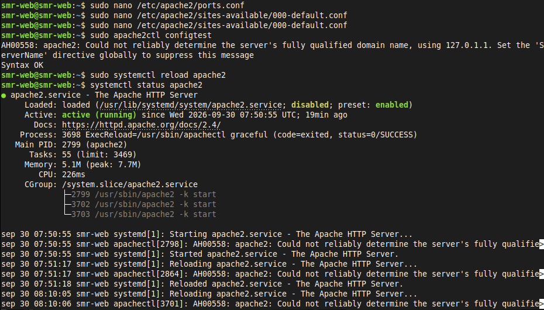

📸 **Captura: respuesta en el puerto 8080**

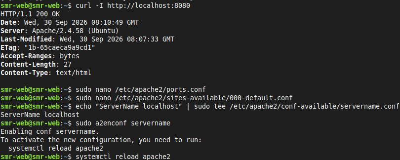

Salida:

```text
HTTP/1.1 200 OK
Server: Apache/2.4.58 (Ubuntu)
Content-Length: 27
Content-Type: text/html
```

**Explicación:** hay que cambiar **dos sitios**: `ports.conf` dice en qué puerto escucha Apache en general y el `VirtualHost` dice qué sitio atiende ese puerto. Si solo cambio uno, no funciona. El `200 OK` en el 8080 demuestra que el cambio funciona. `Syntax OK` en `configtest` indica que no hay errores de escritura.

**Restauración al puerto 80** (obligatorio, si no, el navegador no conecta por el puerto 80 normal):

```bash
sudo nano /etc/apache2/ports.conf                       # Listen 8080  ->  Listen 80
sudo nano /etc/apache2/sites-available/000-default.conf # *:8080  ->  *:80
sudo apache2ctl configtest
sudo systemctl reload apache2
curl -I http://localhost
```

La captura del fichero ya restaurado con `<VirtualHost *:80>` se ve aquí:

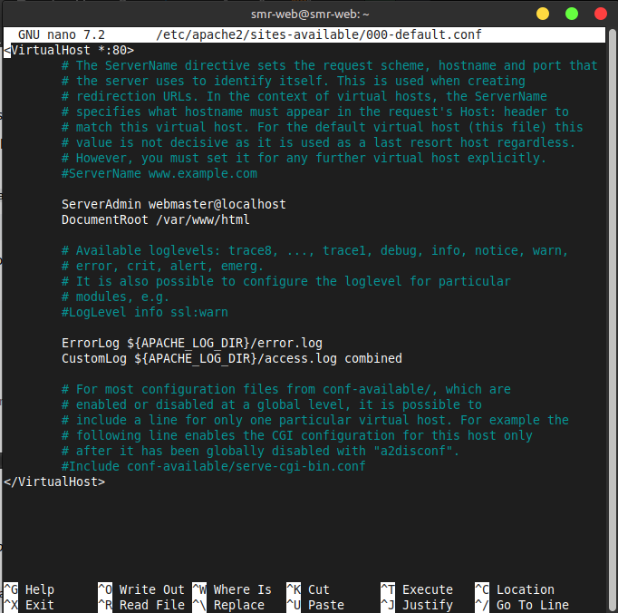


### 6.3. Definir el nombre del servidor (`ServerName`)

```bash
echo "ServerName localhost" | sudo tee /etc/apache2/conf-available/servername.conf
sudo a2enconf servername
sudo systemctl reload apache2
```


Salida del comando:

```text
Enabling conf servername.
To activate the new configuration, you need to run:
  systemctl reload apache2
```

**Explicación:** antes salía el aviso `AH00558: Could not reliably determine the server's fully qualified domain name` porque Apache no sabía cuál era su nombre. Al definir `ServerName localhost` en un fichero propio y activarlo con `a2enconf`, el aviso desaparece al hacer `configtest`. Lo hago en `conf-available` y no en `apache2.conf` para no tocar el fichero principal.

### 6.4. Cambiar el correo del administrador (`ServerAdmin`)

```bash
sudo nano /etc/apache2/sites-available/000-default.conf
```

Cambio la línea:

```apache
ServerAdmin webmaster@localhost
```

por:

```apache
ServerAdmin nabil@servidor.local
```

Después compruebo y recargo:

```bash
sudo apache2ctl configtest
sudo systemctl reload apache2
grep ServerAdmin /etc/apache2/sites-available/000-default.conf
```

Vista del fichero antes del cambio (línea `ServerAdmin webmaster@localhost`):


> 📸 **PENDIENTE:** captura del `grep ServerAdmin` (o del nano) mostrando el correo nuevo.

**Explicación:** `ServerAdmin` es el correo de contacto del administrador. Apache lo puede mostrar en algunas páginas de error. No cambia el funcionamiento, solo informa.

### 6.5. Página de error 404 personalizada

```bash
echo "<h1>Error 404: esta página no existe (servidor de Nabil)</h1>" | sudo tee /var/www/html/404.html
sudo nano /etc/apache2/sites-available/000-default.conf
```

Añado dentro del `<VirtualHost>`:

```apache
ErrorDocument 404 /404.html
```

```bash
sudo apache2ctl configtest
sudo systemctl reload apache2
curl -I http://localhost/paginaquenoexiste
```

Salida esperada: `HTTP/1.1 404 Not Found`. En el navegador, `http://192.168.56.17/paginaquenoexiste` debe mostrar mi mensaje.


**Explicación:** `ErrorDocument` le dice a Apache qué página enseñar cuando ocurre un error concreto. Así el usuario ve un mensaje propio en vez del genérico «Not Found».

---

## 7. Módulos de Apache

Apache es modular: cada función extra es un módulo que se carga solo si hace falta. Esto ahorra memoria y reduce la superficie de ataque.

Módulos cargados actualmente:

```bash
apache2ctl -M
```

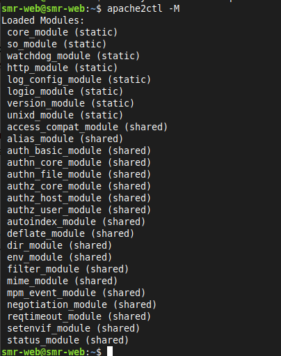

Módulos disponibles (instalados pero no necesariamente activos):

```bash
ls /etc/apache2/mods-available/
```

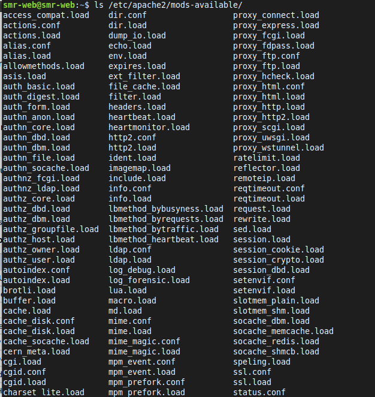

Activo `rewrite`, `headers` y `ssl`, reinicio y compruebo:

```bash
sudo a2enmod rewrite
sudo a2enmod headers
sudo a2enmod ssl
sudo systemctl restart apache2
apache2ctl -M | grep -E "rewrite|headers|ssl"
```

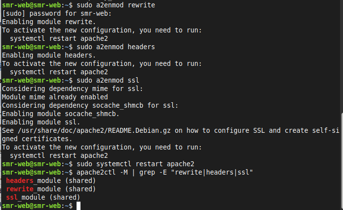

Salida:

```text
 headers_module (shared)
 rewrite_module (shared)
 ssl_module (shared)
```

**Explicación:** al activar `ssl`, `a2enmod` activó además `socache_shmcb` automáticamente porque `ssl` depende de él (mensaje `Considering dependency socache_shmcb for ssl`). El módulo `mime` ya estaba activo. Tras activar módulos hay que **reiniciar** (no basta `reload`).

### Tabla de módulos

| Módulo | Función |
|---|---|
| **mod_rewrite** | Reescritura de URL (por ejemplo, URLs «amigables» o redirecciones con reglas) |
| **mod_headers** | Manipulación de cabeceras HTTP (añadir, cambiar o quitar cabeceras) |
| **mod_ssl** | Soporte de HTTPS (cifrado SSL/TLS) |
| **mod_dir** | Gestión de ficheros índice: sirve `index.html` cuando se pide un directorio |
| **mod_alias** | Redirecciones y alias de rutas (hacer que `/foto` apunte a otra carpeta del disco) |
| **mod_auth_basic** | Autenticación básica con usuario y contraseña |
| **mod_status** | Página de estado del servidor (peticiones, procesos, carga) |
| **mod_php / PHP-FPM** | Ejecución de código PHP (opcional, no instalado por defecto) |

### Desactivar un módulo (`status`)

```bash
sudo a2dismod status
sudo systemctl restart apache2
apache2ctl -M | grep status
```

Tras desactivarlo, el último comando no muestra nada: `status_module` ya no aparece entre los módulos cargados (en la captura 7.1 sí aparecía al final de la lista).

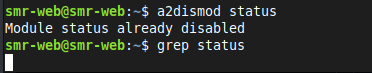

###  ¿Qué ocurre si desactivas un módulo del que depende otro?

Hay dos casos:

- **`a2dismod` avisa:** si otro módulo activo necesita el que quiero quitar, `a2dismod` suele mostrar un aviso o pedir confirmación, porque puede romper cosas.
- **Si lo quito igualmente:** los módulos que dependen de él **dejan de funcionar** o, peor, Apache **no arranca** y muestra un error del tipo `Invalid command ...` al tener directivas que ya no entiende. Por eso hay que ejecutar siempre `apache2ctl configtest` antes de reiniciar, y por eso `a2enmod` activa solo las dependencias al encender (como pasó con `ssl` y `socache_shmcb`).

---

## 8. Varios sitios en un mismo servidor (Virtual Hosts)

Un **virtual host** permite que un mismo Apache sirva varias webs distintas. Voy a crear `sitio1.local` y `sitio2.local`.

### 8.1. Crear los directorios y las páginas

```bash
sudo mkdir -p /var/www/sitio1 /var/www/sitio2
echo "<h1>Bienvenido a SITIO 1</h1>" | sudo tee /var/www/sitio1/index.html
echo "<h1>Bienvenido a SITIO 2</h1>" | sudo tee /var/www/sitio2/index.html
```

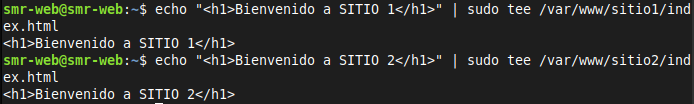

**Explicación:** `mkdir -p` crea ambas carpetas de una vez. Cada sitio tiene su propio `DocumentRoot` con su `index.html`.

### 8.2. Crear los ficheros de configuración

```bash
sudo nano /etc/apache2/sites-available/sitio1.conf
```

Contenido de `sitio1.conf`:

```apache
<VirtualHost *:80>
    ServerName sitio1.local
    ServerAdmin admin@sitio1.local
    DocumentRoot /var/www/sitio1

    <Directory /var/www/sitio1>
        Options -Indexes +FollowSymLinks
        AllowOverride None
        Require all granted
    </Directory>

    ErrorLog ${APACHE_LOG_DIR}/sitio1_error.log
    CustomLog ${APACHE_LOG_DIR}/sitio1_access.log combined
</VirtualHost>
```

Repito para el sitio 2:

```bash
sudo nano /etc/apache2/sites-available/sitio2.conf
```


Contenido de `sitio2.conf`:

```apache
<VirtualHost *:80>
    ServerName sitio2.local
    ServerAdmin admin@sitio2.local
    DocumentRoot /var/www/sitio2

    <Directory /var/www/sitio2>
        Options -Indexes +FollowSymLinks
        AllowOverride None
        Require all granted
    </Directory>

    ErrorLog ${APACHE_LOG_DIR}/sitio2_error.log
    CustomLog ${APACHE_LOG_DIR}/sitio2_access.log combined
</VirtualHost>
```

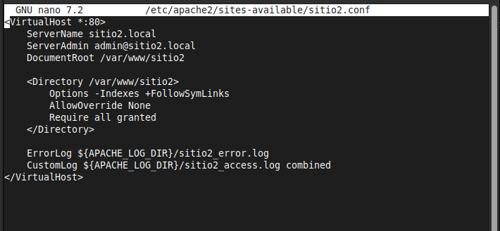

**Explicación de cada directiva:**

| Directiva | Significado |
|---|---|
| `<VirtualHost *:80>` | Este sitio atiende peticiones por el puerto 80 en cualquier IP del servidor |
| `ServerName` | Nombre de dominio que identifica al sitio: Apache lo compara con la cabecera `Host` de la petición |
| `ServerAdmin` | Correo del administrador |
| `DocumentRoot` | Carpeta donde están los ficheros de la web |
| `<Directory>` | Bloque con las reglas para esa carpeta |
| `Options -Indexes` | **No** muestra el listado de ficheros si no hay `index.html` (seguridad) |
| `+FollowSymLinks` | Permite seguir enlaces simbólicos |
| `AllowOverride None` | Ignora los ficheros `.htaccess` (más seguro y rápido) |
| `Require all granted` | Permite el acceso a todo el mundo |
| `ErrorLog` / `CustomLog` | Un log de errores y otro de accesos **propios** de cada sitio |

### 8.3. Activar los sitios y desactivar el de por defecto

```bash
sudo a2ensite sitio1.conf sitio2.conf
sudo a2dissite 000-default.conf
sudo apache2ctl configtest
sudo systemctl reload apache2
apache2ctl -S
```

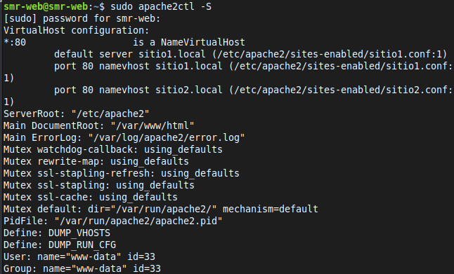

> ```text
> VirtualHost configuration:
> *:80      is a NameVirtualHost
>          default server sitio1.local (/etc/apache2/sites-enabled/sitio1.conf:1)
>          port 80 namevhost sitio1.local (/etc/apache2/sites-enabled/sitio1.conf:1)
>          port 80 namevhost sitio2.local (/etc/apache2/sites-enabled/sitio2.conf:1)
> ```

**Explicación:** `a2ensite` crea los enlaces en `sites-enabled`, `a2dissite` quita el de por defecto para que no interfiera, `configtest` revisa la sintaxis y `reload` aplica los cambios. `apache2ctl -S` confirma que los dos sitios están cargados. El **«default server»** es el primero que Apache encuentra (por orden alfabético: `sitio1.conf`); es el que responde cuando se entra por la IP o por un nombre desconocido.

### 8.4. Resolución de nombres (`/etc/hosts`)

`sitio1.local` y `sitio2.local` no existen en Internet, así que hay que decirle a cada equipo a qué IP corresponden.

**En el servidor Ubuntu** (para probar con `curl` desde dentro):

```bash
sudo nano /etc/hosts
```

Línea añadida al final:

```text
127.0.0.1 sitio1.local sitio2.local
```
más
**En el equipo cliente, Linux Mint** (para probar desde el navegador). Aquí **NO** se pone `127.0.0.1`, porque apuntaría al propio Mint y no al servidor. Se pone la IP de la máquina virtual:

```bash
sudo nano /etc/hosts
```

```text
192.168.56.17 sitio1.local sitio2.local
```

Compruebo que el cliente resuelve el nombre:

```bash
ping -c 3 sitio2.local
```

Debe responder `192.168.56.17`.

### 8.5. Pruebas

```bash
curl http://sitio1.local
curl http://sitio2.local
```


Salida:

```html
<h1>Bienvenido a SITIO 1</h1>
<h1>Bienvenido a SITIO 2</h1>
```

**Explicación:** el servidor es el mismo y la IP también, pero cada nombre devuelve una página distinta. Apache mira el nombre que escribió el cliente (cabecera `Host`) y elige el virtual host que coincide con `ServerName`.

📸 **Captura: ambos sitios en el navegador**

> 📸 **PENDIENTE:** dos capturas de Firefox en Linux Mint, una con `http://sitio1.local` y otra con `http://sitio2.local` (escribir `http://` completo; si se queda cargando, usar ventana privada).

### ❓ ¿Qué diferencia hay entre virtual hosts basados en nombre y basados en IP? ¿Cuál has usado?

| Tipo | Cómo distingue los sitios | Necesita |
|---|---|---|
| **Basados en nombre** | Por el nombre de dominio que pide el cliente (cabecera `Host`) | Una sola IP para todos los sitios |
| **Basados en IP** | Por la dirección IP a la que llega la petición | Una IP distinta por cada sitio |

**He usado virtual hosts basados en nombre**: ambos sitios comparten la IP `192.168.56.17` y el puerto 80, y se diferencian por `ServerName` (`sitio1.local` y `sitio2.local`). Es lo más habitual porque las IPs son limitadas.

---

## 9. Permisos y propietarios

### Comprobar con qué usuario se ejecuta Apache

```bash
ps aux | grep apache2
grep -E "APACHE_RUN_(USER|GROUP)" /etc/apache2/envvars
ls -ld /var/www/sitio1 /var/www/sitio1/index.html
```

Salida esperada:

```text
root      2260  ... /usr/sbin/apache2 -k start
www-data  2262  ... /usr/sbin/apache2 -k start
www-data  2263  ... /usr/sbin/apache2 -k start
export APACHE_RUN_USER=www-data
export APACHE_RUN_GROUP=www-data
```

**Explicación:** el proceso principal lo arranca **root** (necesita permisos para abrir el puerto 80), pero los procesos que atienden las peticiones web se ejecutan como **`www-data`**, un usuario sin privilegios especiales. Esto está definido en `envvars`.

### Aplicar permisos y propietario correctos

```bash
sudo chown -R www-data:www-data /var/www/sitio1
sudo find /var/www/sitio1 -type d -exec chmod 755 {} \;
sudo find /var/www/sitio1 -type f -exec chmod 644 {} \;
ls -ld /var/www/sitio1 /var/www/sitio1/index.html
```

**Explicación:** `chown -R` cambia el propietario y grupo de forma recursiva. `find -type d` selecciona solo directorios y `find -type f` solo ficheros, para poder dar permisos distintos a cada tipo.

### Prueba de fallo: permisos `000` (error 403)

```bash
sudo chmod 000 /var/www/sitio1/index.html
```

Entro desde el navegador a `http://sitio1.local` (o por la IP, que cae en `sitio1` por ser el virtual host por defecto):

📸 **Captura: error 403 en el navegador**


Reviso el log de errores de ese sitio:

```bash
sudo cat /var/log/apache2/sitio1_error.log
# o solo las últimas líneas:
sudo tail -n 5 /var/log/apache2/sitio1_error.log
```

📸 **Captura: registro del error 403 en el log**

> 📸 **PENDIENTE:** captura de la línea del log. Tendrá un aspecto como este (cambiarán la fecha y la IP del cliente):
>
> ```text
> [core:error] [pid 2262] (13)Permission denied: [client 192.168.56.1:5xxxx] AH00132: file permissions deny server access: /var/www/sitio1/index.html
> ```

Restauro los permisos:

```bash
sudo chmod 644 /var/www/sitio1/index.html
curl http://sitio1.local
```

Vuelve a aparecer `<h1>Bienvenido a SITIO 1</h1>`.

**Explicación:** el 403 *Forbidden* significa que Apache **sí está funcionando y encontró** el fichero, pero el usuario `www-data` **no tiene permiso para leerlo**. Es distinto del 404 (el fichero no existe) y del «No se puede conectar» (Apache apagado o puerto equivocado). El log lo confirma con «permission denied» y la ruta exacta.

### ¿Qué significan 755 y 644?

Los permisos se escriben con 3 números: **propietario, grupo, resto del mundo**. Cada número suma: **r = 4** (leer), **w = 2** (escribir), **x = 1** (ejecutar/entrar).

| Permiso | Propietario | Grupo | Otros | Uso |
|---|---|---|---|---|
| **755** | 7 = rwx | 5 = r-x | 5 = r-x | **Directorios**: el dueño lo puede todo; los demás pueden entrar y listar, pero no modificar |
| **644** | 6 = rw- | 4 = r-- | 4 = r-- | **Ficheros**: el dueño lee y escribe; los demás solo leen |

Los directorios necesitan la `x` porque para **entrar** en una carpeta hace falta permiso de ejecución. Los ficheros web normales (HTML, imágenes) no se ejecutan, por eso no llevan `x`. Con esta política Apache puede **leer y servir** la web, pero ni los visitantes ni un atacante que consiga controlar el proceso web pueden **modificar** el contenido.

### ¿Por qué nunca se debe usar 777 en un servidor web?

`777` (`rwxrwxrwx`) da permiso de **leer, escribir y ejecutar a todos los usuarios del sistema**. Es peligroso porque:

- Cualquier usuario o proceso del sistema puede **modificar o borrar** la web.
- Si hay una vulnerabilidad en una aplicación web, un atacante puede **subir o cambiar ficheros** (por ejemplo, una puerta trasera o código malicioso) y ejecutarlos.
- Se pierde el principio de **mínimo privilegio**: cada cosa debe tener solo los permisos imprescindibles.

### ¿Por qué el contenido web no debe pertenecer a root ni ser escribible por todos?

- **Si pertenece a root:** `www-data` no podría escribir ahí aunque fuera necesario (subidas, cachés), y administrar la web con root es mala práctica, porque un error o un ataque tendría efecto sobre todo el sistema. Lo correcto es que el contenido sea de `www-data` (o de un usuario de despliegue) y que Apache **no** funcione con root.
- **Si Apache funcionara como root:** cualquier fallo de seguridad en la web daría al atacante **control total de la máquina**. Por eso Apache baja los privilegios y atiende peticiones como `www-data`, un usuario limitado: si lo comprometen, el daño queda limitado.
- **Si es escribible por todos:** cualquiera podría alterar la web (defacement) o inyectar código.

---

## 10. Tabla de fallos encontrados

| Nº | Problema | Causa | Solución |
|---|---|---|---|
| 1 | Aviso `AH00558: Could not reliably determine the server's fully qualified domain name` | Apache no tenía definido `ServerName` | Crear `servername.conf` con `ServerName localhost`, activarlo con `a2enconf` y recargar (apartado 6.3) |
| 2 | Al entrar por la IP solo aparecía el sitio 1 | Con virtual hosts por nombre, al entrar por IP responde el **primero** (por defecto) | Entrar con el nombre `http://sitio2.local` y no con la IP |
| 3 | `sitio2.local` no cargaba en el navegador | El cliente (Linux Mint) no sabía a qué IP corresponde el nombre | Añadir `192.168.56.17 sitio1.local sitio2.local` en `/etc/hosts` **del Mint** |
| 4 | En `/etc/hosts` había `127.0.0.1` y no funcionaba desde el navegador | `127.0.0.1` es la propia máquina; en el Mint apuntaba a Mint y no al servidor | Poner la IP de la máquina virtual (`192.168.56.17`) en el `hosts` del cliente; dejar `127.0.0.1` solo en el servidor para `curl` |
| 5 | Firefox: «No se puede conectar» | Apache estaba parado: `Active: inactive (dead)` y `disabled` | `sudo systemctl start apache2` y `sudo systemctl enable apache2` |
| 6 | Firefox: `SSL_ERROR_RX_RECORD_TOO_LONG` | El navegador intentaba usar **HTTPS** contra el puerto 80, que solo habla HTTP | Escribir explícitamente `http://` (no `https://`) o usar ventana privada |
| 7 | Tras la prueba del puerto 8080 el navegador no conectaba | Olvidé volver a poner el puerto 80 en `ports.conf` y `000-default.conf` | Restaurar `Listen 80` y `<VirtualHost *:80>`, `configtest` y `reload` |

---

## 11. Conclusiones

Con esta práctica he aprendido a instalar, comprobar y administrar un servidor web Apache2 en Ubuntu Server 24.04. He entendido cómo se organiza su configuración: los ficheros reales están en `*-available` y se activan con enlaces simbólicos en `*-enabled` mediante los comandos `a2ensite`, `a2enmod` y `a2enconf`. También he visto que Apache es **modular** y que conviene activar solo lo necesario.

Lo más útil ha sido montar **dos sitios en un mismo servidor** con virtual hosts por nombre, y entender que para que el navegador de otro equipo los encuentre hay que resolver los nombres (con `/etc/hosts` apuntando a la IP del servidor, no a `127.0.0.1`). En seguridad, he comprobado por qué Apache corre como `www-data`, por qué se usan permisos **755/644** y qué se ve cuando faltan permisos (error **403** y su línea en el log).

**Problemas encontrados y cómo los solucioné** (resumen de la tabla del apartado 10):

- Apache aparecía parado y deshabilitado → lo inicié y lo habilité con `systemctl`.
- El navegador forzaba HTTPS → escribí `http://` de forma explícita.
- No cargaba `sitio2.local` → añadí la IP correcta del servidor en el `/etc/hosts` del equipo cliente.
- Cambié el puerto a 8080 para la prueba → después lo restauré al 80 en los dos ficheros.

La principal lección es **diagnosticar por capas**: primero comprobar que el servicio está activo (`systemctl status`), después la configuración (`apache2ctl configtest`), luego la resolución de nombres, y por último los permisos y los logs. Los comandos `curl` y los ficheros `error.log` han sido las herramientas más rápidas para localizar cada fallo.
