# Práctica: Instalación de WordPress en Ubuntu 24.04

| | |
|---|---|
| **Alumno** | Nabil Aisatin |
| **Ciclo** | Sistemas Microinformáticos y Redes (SMR) |
| **Módulo** | Aplicaciones Web |
| **Curso** | 2026/2027 |
| **Fecha** | Octubre de 2026 |
| **Servidor** | Ubuntu Server 24.04 (máquina virtual, usuario `smr-web`, IP `192.168.56.17`) |
| **Equipo cliente** | Linux Mint (navegador Firefox) |

>  **Seguridad:** en esta memoria **no aparece ninguna contraseña**. Donde iría una, se escribe `********` y en las capturas está tapada.

---

## Índice

0. [Introducción: cómo se usa una herramienta gráfica en un servidor sin pantalla](#0-introducción-cómo-se-usa-una-herramienta-gráfica-en-un-servidor-sin-pantalla)
1. [Conexión por SSH y comprobación del servidor](#1-conexión-por-ssh-y-comprobación-del-servidor)
2. [Dejar Apache con un único sitio](#2-dejar-apache-con-un-único-sitio)
3. [Crear la base de datos de WordPress](#3-crear-la-base-de-datos-de-wordpress)
4. [Descargar e instalar los ficheros de WordPress](#4-descargar-e-instalar-los-ficheros-de-wordpress)
5. [Terminar la instalación desde el navegador](#5-terminar-la-instalación-desde-el-navegador)
6. [Comprobamos que WordPress funciona](#6-comprobamos-que-wordpress-funciona)
7. [Para que no se rompa si cambia la IP](#7-para-que-no-se-rompa-si-cambia-la-ip)
8. [Dos ajustes para trabajar cómodamente](#8-dos-ajustes-para-trabajar-cómodamente)
9. [¿Qué pasa si MariaDB se para?](#9-qué-pasa-si-mariadb-se-para)
10. [Comprobación final](#10-comprobación-final)
11. [Chuleta de comandos](#11-chuleta-de-comandos)
12. [Conclusiones y problemas encontrados](#12-conclusiones-y-problemas-encontrados)

---

## 0. Introducción: cómo se usa una herramienta gráfica en un servidor sin pantalla

Mi servidor Ubuntu **no tiene escritorio, ventanas ni ratón**: solo una terminal de texto. Pero **WordPress no es un programa que se abra en el servidor, es una web**. El servidor solo envía páginas (texto con instrucciones de cómo dibujarlas) y **es el navegador de mi ordenador el que las dibuja**. Por eso el servidor no necesita interfaz gráfica.

Analogía del restaurante:

| En el restaurante | En nuestro caso |
|---|---|
| La **cocina** prepara los platos, pero el cliente no la ve | El **servidor** guarda y prepara WordPress, pero no dibuja nada |
| El **comedor** es donde el cliente ve y toca los platos | El **navegador de mi ordenador** es donde veo y uso WordPress |
| El **camarero** lleva los platos de la cocina al comedor | **Apache** lleva las páginas del servidor al navegador |

**Las dos «puertas» para conectarme al servidor:**

| Puerta | Para qué se usa | Programa |
|---|---|---|
| **SSH** (puerto 22) | **Administrar** el servidor: instalar, copiar, configurar (modo texto) | Terminal (`ssh`) |
| **HTTP** (puerto 80) | **Usar** WordPress: ver la web y el panel de control (modo gráfico) | Navegador |

**¿Qué es WordPress?** Es un **gestor de contenidos (CMS)**: una aplicación web que permite crear y mantener webs sin programar (entradas, páginas, imágenes, temas de diseño y plugins). Está hecha en **PHP** y guarda todo su contenido en la base de datos de **MariaDB**.

**Qué se hace en cada sitio:**

| Dónde | Qué se hace |
|---|---|
| **Terminal (por SSH)** | Preparar Apache, crear la base de datos, descargar WordPress, copiarlo a Apache y darle permisos |
| **Navegador** | Terminar la instalación con un asistente gráfico (título, usuario y contraseña) y después trabajar con WordPress |

---

## 1. Conexión por SSH y comprobación del servidor

### 1.1. Averiguar la IP del servidor

```bash
hostname -I
```

Salida:

```text
10.0.2.15 192.168.56.17 fd17:625c:f037:2:a00:27ff:fe45:b45d
```


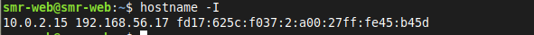

**Explicación:** `hostname -I` muestra todas las direcciones IP de la máquina. Aparecen tres:

- `10.0.2.15`: red NAT de VirtualBox (da salida a Internet a la máquina virtual, pero desde fuera no se puede llegar a ella).
- **`192.168.56.17`**: red *host-only*. Es la que uso para conectarme desde mi ordenador, porque es la que comparten el anfitrión y la máquina virtual.
- `fd17:…`: dirección IPv6.

### 1.2. Conectarme por SSH desde mi ordenador

Desde una terminal de mi ordenador (Linux Mint):

```bash
ssh smr-web@192.168.56.17
```

La primera vez pregunta si confío en el servidor (escribo `yes`) y luego pide la contraseña de mi usuario. A partir de aquí **todos los comandos de la práctica se escriben en esta terminal**.

**Explicación:** `ssh usuario@IP` abre una sesión de terminal remota y **cifrada** en el servidor. Así administro la máquina virtual desde mi ordenador sin usar su consola.

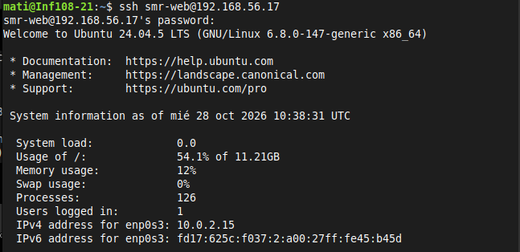

### 1.3. Comprobar que lo anterior sigue funcionando

```bash
systemctl is-active apache2 mariadb
php -v
```


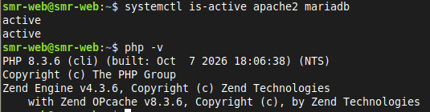

Salida:

```text
active
active
PHP 8.3.6 (cli) (built: Oct  7 2026 18:06:38) (NTS)
```

**Explicación:** `active` dos veces significa que Apache y MariaDB están funcionando, y PHP responde con la versión 8.3.6. Las tres piezas que necesita WordPress están listas.

###  ¿Qué dos «puertas» (programas y puertos) usas para trabajar con el servidor en esta práctica y para qué sirve cada una?

**Respuesta:**

1. **SSH, puerto 22, con la terminal (`ssh`):** sirve para **administrar** el servidor en modo texto: instalar paquetes, crear la base de datos, descargar y copiar WordPress, dar permisos, editar ficheros.
2. **HTTP, puerto 80, con el navegador:** sirve para **usar** WordPress de forma gráfica: ver la web pública, terminar el asistente de instalación y trabajar en el panel de administración.

---

## 2. Dejar Apache con un único sitio

En la práctica de Apache creé dos sitios (`sitio1` y `sitio2`) y desactivé el de por defecto. Ahora el servidor tendrá **un solo sitio**, el de por defecto, cuya carpeta es `/var/www/html`, y WordPress se instalará ahí. Entraré con la IP del servidor.

### 2.1. Cambiar los sitios activos

```bash
sudo a2dissite sitio1.conf sitio2.conf
sudo a2ensite 000-default.conf
sudo apache2ctl configtest
sudo systemctl reload apache2
```


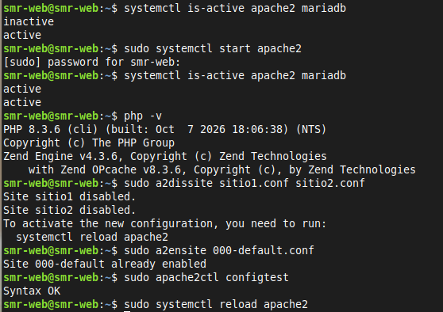

Salida:

```text
Site sitio1 disabled.
Site sitio2 disabled.
To activate the new configuration, you need to run:
  systemctl reload apache2
Site 000-default already enabled
Syntax OK
```

**Explicación:**

- `a2dissite` **desactiva** `sitio1` y `sitio2`: borra sus enlaces simbólicos de `sites-enabled`, pero **no** sus ficheros de `sites-available`.
- `a2ensite 000-default.conf` activa el sitio por defecto. Aquí dice `already enabled` porque ya lo había activado en la práctica de MariaDB.
- `configtest` comprueba la sintaxis: `Syntax OK` significa que no hay errores.
- `reload` aplica los cambios sin cortar las conexiones.

>  En la captura se ve que al empezar `apache2` salía **`inactive`** (Apache estaba parado, tras reiniciar la máquina virtual). Lo arranqué con `sudo systemctl start apache2` y volvió a `active`. Ver [apartado 12](#12-conclusiones-y-problemas-encontrados).

**Si aparece el aviso del `ServerName`:**

```text
AH00558: Could not reliably determine the server's fully qualified domain name...
```

Se soluciona definiendo un nombre de servidor global:

```bash
echo "ServerName localhost" | sudo tee /etc/apache2/conf-available/servername.conf
sudo a2enconf servername
sudo apache2ctl configtest
sudo systemctl reload apache2
```

Después, `configtest` debe mostrar únicamente `Syntax OK`.

### 2.2. Comprobar que solo hay un sitio activo y qué carpeta usa

```bash
ls /etc/apache2/sites-enabled/
grep DocumentRoot /etc/apache2/sites-enabled/000-default.conf
```


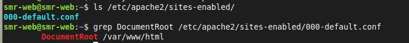

Salida:

```text
000-default.conf
        DocumentRoot /var/www/html
```

**Explicación:** `sites-enabled` solo contiene `000-default.conf`, así que hay **un único sitio activo**. `grep DocumentRoot` busca esa palabra en el fichero y muestra la carpeta desde la que Apache sirve la web: `/var/www/html`. Ahí instalaré WordPress.

### 2.3. Comprobar que el navegador llega al servidor

En el navegador de mi ordenador abro `http://192.168.56.17`.

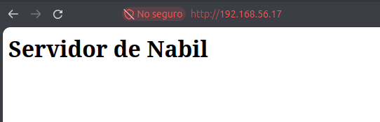

**Explicación:** aparece mi página «Servidor de Nabil» (la de la primera práctica). Entro con la **IP** y ya no hace falta usar `sitio1.local` ni `sitio2.local`.

###  ¿Qué diferencia hay entre desactivar un sitio con `a2dissite` y borrar sus ficheros? ¿Por qué ahora ves la página por defecto de Apache y antes veías `sitio1`?

**Respuesta:**

- **`a2dissite`** solo **quita el enlace simbólico** de `sites-enabled`. Apache deja de servir ese sitio, pero el fichero de configuración sigue en `sites-available` y la web sigue en `/var/www/sitio1`. Se puede **volver a activar** en cualquier momento con `a2ensite`.
- **Borrar los ficheros** elimina el sitio de forma **definitiva**: habría que escribirlo otra vez desde cero.
- **Por qué cambió lo que veo:** antes estaban activos `sitio1` y `sitio2` (virtual hosts por nombre) y el sitio por defecto desactivado; al entrar por IP respondía el primero (`sitio1`). Ahora está activo **solo** `000-default.conf`, cuyo `DocumentRoot` es `/var/www/html`, así que entrando por la IP veo el contenido de esa carpeta.

---

## 3. Crear la base de datos de WordPress

WordPress guarda todo en una base de datos de MariaDB. Analogía del armario con una llave:

| Qué creamos | Nombre | Para qué |
|---|---|---|
| El **armario** (base de datos) | `wordpress` | Donde WordPress guardará todos sus datos |
| La **llave** (usuario) | `wp_user` | Con lo que WordPress entra en el armario |
| El **permiso** | Todos, pero **solo sobre `wordpress`** | Esa llave abre ese armario y ningún otro |

La contraseña de `wp_user` debe tener mínimo 12 caracteres (letras, números y guion bajo `_`). En esta memoria aparece como `********`.

Entro en MariaDB como administrador:

```bash
sudo mariadb
```

Dentro, escribo estas tres órdenes (cada una termina en `;`):

```sql
CREATE DATABASE wordpress;
CREATE USER 'wp_user'@'localhost' IDENTIFIED BY '********';
GRANT ALL ON wordpress.* TO 'wp_user'@'localhost';
exit
```


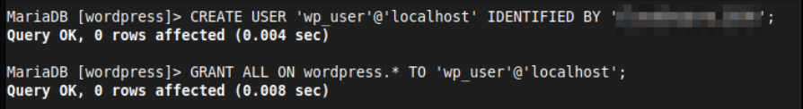

Salida de cada una:

```text
Query OK, 0 rows affected
```

**Qué hace cada orden:**

| Orden | Qué hace |
|---|---|
| `CREATE DATABASE wordpress;` | Crea el **armario**: una base de datos vacía llamada `wordpress` |
| `CREATE USER 'wp_user'@'localhost' IDENTIFIED BY '...';` | Crea la **llave**: un usuario `wp_user` que solo puede conectarse desde `localhost` (el propio servidor) y le pone contraseña |
| `GRANT ALL ON wordpress.* TO 'wp_user'@'localhost';` | Da **todos los permisos** a `wp_user` sobre **todas las tablas** (`.*`) de la base `wordpress`, y solo sobre esa |

### Comprobar que la llave funciona

```bash
mariadb -u wp_user -p wordpress
```

Pide la contraseña (al escribirla no se ve nada, es normal). Si aparece el prompt `MariaDB [wordpress]>`, funciona. Salgo con `exit`.

**Explicación:** `-u wp_user` indica el usuario, `-p` pide la contraseña y `wordpress` es la base de datos a la que entro.


> **Si me equivoco y quiero empezar de nuevo:** `sudo mariadb`, y ejecutar `DROP DATABASE wordpress;` y `DROP USER 'wp_user'@'localhost';`. Luego repetir las tres órdenes.

###  ¿Por qué WordPress usa su propio usuario `wp_user` con permiso solo sobre su base y no el usuario `root` de MariaDB?

**Respuesta:** por **seguridad** y por el **principio de mínimo privilegio**: cada cosa debe tener solo los permisos que necesita.

- `root` de MariaDB puede hacerlo **todo**: ver, modificar y borrar **todas** las bases de datos y crear usuarios.
- Si WordPress usara `root` y alguien lo atacara (por ejemplo, con un plugin vulnerable), el atacante tendría **control total del gestor de bases de datos** y de todas las bases del servidor.
- Con `wp_user`, si lo comprometen, **el daño queda limitado** a la base `wordpress`.
- Además, la contraseña de `wp_user` se guarda en `wp-config.php`; es mucho mejor que ahí no esté la de `root`.

---

## 4. Descargar e instalar los ficheros de WordPress

### 4.1. Descargar y descomprimir (en la carpeta temporal)

```bash
sudo apt install wget -y
cd /tmp
wget https://wordpress.org/latest.tar.gz
tar -xzf latest.tar.gz
ls wordpress
```

Aparecen ficheros como `index.php`, `wp-admin`, `wp-content` y `wp-config-sample.php`.


### 4.2. Colocarlo en la carpeta del sitio

Primero quito la página de bienvenida de Apache (si no, tendría prioridad sobre WordPress) y después copio todo el contenido:

```bash
sudo rm /var/www/html/index.html
sudo cp -a /tmp/wordpress/. /var/www/html/
rm -r /tmp/wordpress /tmp/latest.tar.gz
ls /var/www/html
```

Ahora WordPress está en `/var/www/html` y se ve en `http://192.168.56.17/`.

> Si el navegador sigue mostrando la página anterior («Servidor de Nabil»), es caché. Se puede comprobar con `curl -I http://localhost`.


###  Explica qué hace cada uno de los comandos que acabas de ejecutar (4.1 y 4.2)

| Comando | Qué hace |
|---|---|
| `sudo apt install wget -y` | Instala `wget`, programa para **descargar ficheros de Internet** desde la terminal (`-y` responde «sí» a todo) |
| `cd /tmp` | **Cambia a la carpeta `/tmp`**, la carpeta temporal del sistema. Lo que pongo ahí es provisional |
| `wget https://wordpress.org/latest.tar.gz` | **Descarga** la última versión de WordPress, un fichero comprimido `.tar.gz` |
| `tar -xzf latest.tar.gz` | **Descomprime** el fichero: `x` = extraer, `z` = está comprimido con gzip, `f` = el fichero es el que indico. Crea la carpeta `wordpress` |
| `ls wordpress` | **Lista** el contenido de esa carpeta para comprobar que se descomprimió bien |
| `sudo rm /var/www/html/index.html` | **Borra** la página de bienvenida de Apache. Si no, Apache la serviría antes que `index.php` de WordPress |
| `sudo cp -a /tmp/wordpress/. /var/www/html/` | **Copia todo** el contenido de la carpeta `wordpress` a `/var/www/html`. `-a` (*archive*) conserva la estructura, los permisos y los ficheros ocultos; el `.` final del origen indica «todo el contenido, incluidos ocultos» |
| `rm -r /tmp/wordpress /tmp/latest.tar.gz` | **Borra** la carpeta temporal y el comprimido, que ya no hacen falta (`-r` = recursivo, para carpetas) |
| `ls /var/www/html` | **Lista** la carpeta del sitio para comprobar que WordPress está ahí |
| `curl -I http://localhost` | Pide solo las **cabeceras** de la web para ver si responde (`200 OK`) sin la caché del navegador |

### 4.3. Dar los permisos correctos

Apache se ejecuta con el usuario `www-data`, y WordPress necesita poder escribir (guardar imágenes, instalar plugins, crear su configuración…):

```bash
sudo chown -R www-data:www-data /var/www/html
sudo find /var/www/html -type d -exec chmod 755 {} \;
sudo find /var/www/html -type f -exec chmod 644 {} \;
ls -ld /var/www/html
```

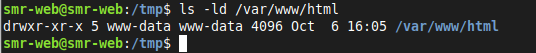

Salida:

```text
drwxr-xr-x 5 www-data www-data 4096 Oct  6 16:05 /var/www/html
```

**Explicación de cada orden:**

| Orden | Qué hace |
|---|---|
| `sudo chown -R www-data:www-data /var/www/html` | Cambia el **propietario y el grupo** de la carpeta y de **todo** lo que contiene (`-R` = recursivo) a `www-data` |
| `sudo find /var/www/html -type d -exec chmod 755 {} \;` | Busca solo los **directorios** (`-type d`) y les pone permisos **755** (`rwxr-xr-x`) |
| `sudo find /var/www/html -type f -exec chmod 644 {} \;` | Busca solo los **ficheros** (`-type f`) y les pone permisos **644** (`rw-r--r--`) |
| `ls -ld /var/www/html` | Muestra los permisos y el propietario **de la propia carpeta** (`-d` evita listar su contenido) |

La captura muestra `drwxr-xr-x ... www-data www-data`: propietario y grupo son `www-data`.

###  ¿Por qué hay que cambiar el propietario de la carpeta de WordPress a `www-data`? ¿Qué podría fallar si siguiera siendo mi usuario?

**Respuesta:** Apache ejecuta los procesos web con el usuario **`www-data`**, así que cuando WordPress necesita **escribir** en el disco lo hace como `www-data`. Si la carpeta siguiera siendo de mi usuario (o de `root`) con permisos 755/644, `www-data` solo podría **leer** y fallarían cosas como:

- **Subir imágenes** a la biblioteca de medios (`wp-content/uploads`).
- **Instalar o actualizar plugins y temas**, y las **actualizaciones automáticas** de WordPress.
- **Crear `wp-config.php`** durante el asistente de instalación.
- **Crear el `.htaccess`** de los enlaces permanentes.

WordPress pediría datos de FTP o mostraría errores de «no se puede escribir en el directorio».

---

## 5. Terminar la instalación desde el navegador

Ahora viene la parte visual. **En el navegador de mi ordenador** abro `http://192.168.56.17` y aparece el asistente de instalación.

| Pantalla | Qué hacer |
|---|---|
| **1. Idioma** | Elegir **Español** y pulsar *Continuar* |
| **2. Bienvenida** | Pulsar *¡Vamos a ello!* |
| **3. Datos de la base de datos** | Rellenar la tabla de abajo y pulsar *Enviar* |
| **4. Todo en orden** | Pulsar *Iniciar la instalación* |
| **5. Información necesaria** | Rellenar la segunda tabla y pulsar *Instalar WordPress* |
| **6. Éxito** | Pulsar *Iniciar sesión* |

**Pantalla 3: datos de la base de datos**

| Campo | Qué escribir |
|---|---|
| Nombre de la base de datos | `wordpress` |
| Nombre de usuario | `wp_user` |
| Contraseña | `********` (la elegida en el apartado 3) |
| Servidor de la base de datos | `localhost` |
| Prefijo de tabla | `wp_` (se deja como está) |

**Pantalla 5: datos del sitio**

| Campo | Qué escribir |
|---|---|
| Título del sitio | `Mi Primer WordPress` |
| Nombre de usuario | `pako` (**nunca `admin`**, es el primero que prueban los atacantes) |
| Contraseña | `********` (una fuerte; la propone WordPress) |
| Tu correo electrónico | un correo de práctica, por ejemplo `nabil@ejemplo.local` |
| Visibilidad en motores de búsqueda | Marcado *Disuadir a los motores de búsqueda* (es un sitio de prácticas) |

> 📸 **PENDIENTE: 3 capturas** (con las contraseñas **tapadas**):
> 1. Pantalla 3 (datos de la base de datos) → `img/wordpress-5.1.png`
> 2. Pantalla 5 (datos del sitio) → `img/wordpress-5.2.png`
> 3. El **escritorio de WordPress** una vez dentro → `img/wordpress-5.3.png`

**Qué ha pasado por debajo:** al enviar la pantalla 3, WordPress comprobó que podía entrar en la base de datos y **creó él solo** su fichero de configuración, `wp-config.php` (por eso necesita que `www-data` pueda escribir en la carpeta). En la pantalla 5 creó las **tablas** en MariaDB y mi **usuario administrador**.

###  ¿Qué partes de la instalación has hecho en la terminal y cuáles en el navegador? ¿Por qué el servidor no necesita interfaz gráfica?

**Respuesta:**

| Terminal (por SSH) | Navegador |
|---|---|
| Comprobar servicios, dejar un único sitio en Apache, crear la base de datos y el usuario, descargar y descomprimir WordPress, copiarlo a Apache y dar permisos | Elegir idioma, introducir los datos de la base de datos, crear el título del sitio y el usuario administrador, iniciar sesión y trabajar con WordPress |

El servidor **no necesita interfaz gráfica** porque WordPress es una **aplicación web**: el servidor solo genera y envía las páginas (HTML), y es el **navegador de mi ordenador** el que las dibuja y recoge lo que escribo. Apache hace de «camarero» entre los dos.

---

## 6. Comprobamos que WordPress funciona

### 6.1. La web pública

Abro `http://192.168.56.17`: debe verse el sitio con el título «Mi Primer WordPress».

### 6.2. El panel de administración

Abro `http://192.168.56.17/wp-admin` e inicio sesión con mi usuario administrador.

### 6.3. Publicar una entrada de prueba

En el panel: *Entradas → Añadir nueva*. Escribo un título y un texto (mi nombre y la fecha), pulso *Publicar* y compruebo que aparece en la web pública.


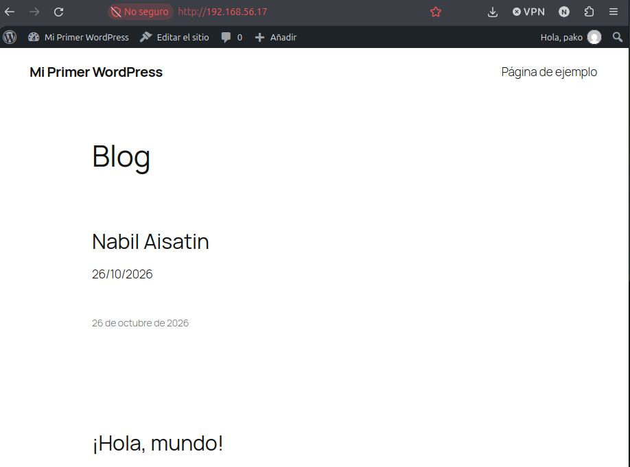

**Explicación:** en el blog se ve la entrada **«Nabil Aisatin»** con fecha 26/10/2026 (la que acabo de publicar) y debajo la entrada de ejemplo «¡Hola, mundo!». La barra negra superior («Hola, pako») indica que estoy dentro del panel con la sesión iniciada.

### 6.4. ¿Dónde ha guardado WordPress mi entrada? En la base de datos

```bash
sudo mariadb wordpress -e "SHOW TABLES;"
```


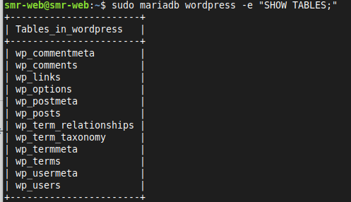

Salida:

```text
+-----------------------+
| Tables_in_wordpress   |
+-----------------------+
| wp_commentmeta        |
| wp_comments           |
| wp_links              |
| wp_options            |
| wp_postmeta           |
| wp_posts              |
| wp_term_relationships |
| wp_term_taxonomy      |
| wp_termmeta           |
| wp_terms              |
| wp_usermeta           |
| wp_users              |
+-----------------------+
```

**Explicación:** `sudo mariadb wordpress -e "SHOW TABLES;"` entra en la base `wordpress` y ejecuta (`-e`) el comando `SHOW TABLES;`, que lista las tablas. Son **12 tablas** y todas empiezan por `wp_` (el prefijo). Las más importantes:

| Tabla | Qué guarda |
|---|---|
| `wp_posts` | **Entradas y páginas** |
| `wp_users` | **Usuarios** |
| `wp_options` | **Configuración** del sitio (título, URL, tema activo…) |
| `wp_comments` | Comentarios |

### 6.5. Dónde está cada cosa

| Qué | Dónde |
|---|---|
| Los ficheros de WordPress | `/var/www/html/` |
| La conexión con la base de datos | `/var/www/html/wp-config.php` (**no se comparte nunca**: contiene la contraseña) |
| Temas, plugins e imágenes subidas | `/var/www/html/wp-content/` (carpetas `themes`, `plugins` y `uploads`) |
| Las entradas, usuarios y ajustes | En la base de datos `wordpress` de MariaDB |

###  ¿Dónde guarda WordPress las entradas que escribes: en ficheros del servidor o en la base de datos? ¿Cómo lo has comprobado?

**Respuesta:** las entradas se guardan en la **base de datos** (tabla `wp_posts`), **no** en ficheros. Lo comprobé ejecutando `sudo mariadb wordpress -e "SHOW TABLES;"`, que muestra las tablas que WordPress creó en MariaDB, entre ellas `wp_posts`. Los ficheros del servidor (`/var/www/html`) contienen el **programa** de WordPress, los temas, los plugins y las imágenes subidas, pero no el texto de las entradas.

> Para ver la entrada dentro de la tabla: `sudo mariadb wordpress -e "SELECT ID, post_title, post_status FROM wp_posts;"`

---

## 7. Para que no se rompa si cambia la IP

WordPress **apunta en su base de datos la dirección con la que lo instalé**. Si la IP de la máquina virtual cambia (por ejemplo, al reiniciarla), WordPress seguiría usando la antigua: la web se vería **sin diseño** y el panel me llevaría a una dirección que ya no existe.

Con dos líneas le digo: *«usa siempre la dirección con la que te estén visitando»*:

```bash
sudo nano /var/www/html/wp-config.php
```

Busco la línea `/* That's all, stop editing! ... */` (en nano: `Ctrl+W`, escribo `That's all` y `Enter`) y coloco estas dos líneas junto a ella, **antes** de la línea `require_once ABSPATH . 'wp-settings.php';`:

```php
define( 'WP_HOME', 'http://' . $_SERVER['HTTP_HOST'] );
define( 'WP_SITEURL', 'http://' . $_SERVER['HTTP_HOST'] );
```

Guardo con `Ctrl+O`, `Enter` y salgo con `Ctrl+X`. Compruebo que no hay errores:

```bash
php -l /var/www/html/wp-config.php
```


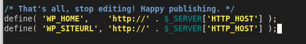


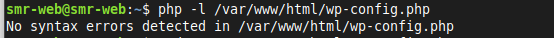

Salida:

```text
No syntax errors detected in /var/www/html/wp-config.php
```

**Explicación:**

- `WP_HOME` es la dirección de la **web** y `WP_SITEURL` la de los **ficheros de WordPress**. Normalmente están guardadas en la tabla `wp_options`; al definirlas en `wp-config.php` **tienen prioridad** sobre la base de datos.
- `$_SERVER['HTTP_HOST']` es una variable de PHP con el **nombre o IP con el que el visitante ha llamado al servidor**. Así, si entro con otra IP, WordPress usa esa.
- `php -l` (*lint*) revisa la **sintaxis** del fichero PHP sin ejecutarlo. `No syntax errors detected` significa que no me equivoqué al escribirlo (una errata aquí rompería toda la web).

> En la captura las dos líneas quedan justo debajo del comentario `/* That's all, stop editing! */`. Funciona porque siguen estando **antes** de `require_once ABSPATH . 'wp-settings.php';`, que es lo que carga WordPress. Se puede comprobar con `tail -n 8 /var/www/html/wp-config.php`.

> Estas dos líneas son cómodas para un laboratorio. En un servidor real se escribiría la dirección fija del sitio.

---

## 8. Dos ajustes para trabajar cómodamente

### 8.1. Direcciones «bonitas» (enlaces permanentes)

Por defecto, las entradas tienen direcciones como `http://IP/?p=1`. WordPress puede usar direcciones más claras, como `http://IP/mi-entrada/`, pero para eso crea un fichero llamado **`.htaccess`**, que Apache **por defecto ignora**. Si no lo permito, al cambiar el formato las entradas dan **error 404**.

Primero permito a Apache leer ese fichero en la carpeta de WordPress:

```bash
sudo nano /etc/apache2/conf-available/wordpress.conf
```

Contenido:

```apache
<Directory /var/www/html>
    AllowOverride All
</Directory>
```


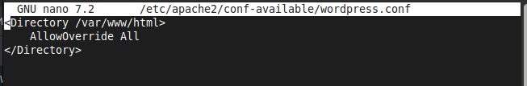

Lo activo (el módulo `rewrite` ya estaba activado, pero así me aseguro):

```bash
sudo a2enmod rewrite
sudo a2enconf wordpress
sudo apache2ctl configtest
sudo systemctl restart apache2
```

**Explicación:**

- `AllowOverride All` le dice a Apache que **sí** lea los ficheros `.htaccess` de esa carpeta y aplique sus reglas. (El valor `None` los ignora.)
- `a2enmod rewrite` activa el módulo que permite **reescribir URLs**, que es lo que usan las reglas del `.htaccess` de WordPress.
- `a2enconf wordpress` activa el fichero `wordpress.conf` (crea el enlace en `conf-enabled`).
- `configtest` revisa la sintaxis y `restart` reinicia Apache para aplicar el cambio.

Después, en el panel de WordPress: *Ajustes → Enlaces permanentes → Nombre de la entrada → Guardar cambios*.


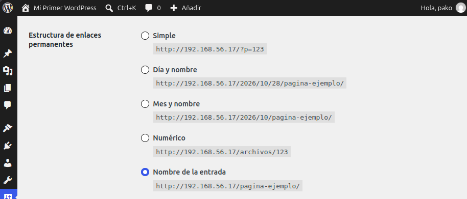

**Explicación:** en el panel se elige la estructura **«Nombre de la entrada»** (`http://192.168.56.17/pagina-ejemplo/`) en lugar de la «Simple» (`/?p=123`).


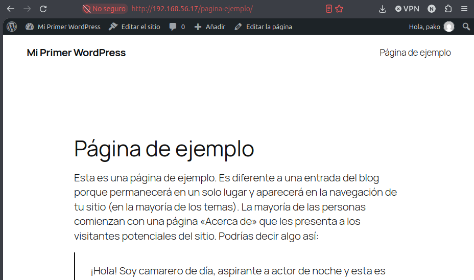

**Explicación:** la página se abre en `http://192.168.56.17/pagina-ejemplo/` y se ve correctamente (no da 404). La dirección es clara y legible.

WordPress habrá creado solo el fichero `.htaccess`:

```bash
ls -la /var/www/html/.htaccess
```

Salida esperada:

```text
-rw-r--r-- 1 www-data www-data 261 ... /var/www/html/.htaccess
```

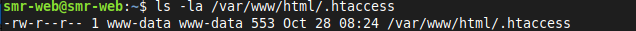

### 8.2. Poder subir ficheros grandes

PHP, por defecto, solo deja subir ficheros de **2 MB**. Muchos temas, plugins y fotos pesan más, así que subo el límite a **64 MB**:

```bash
printf 'upload_max_filesize = 64M\npost_max_size = 64M\n' | sudo tee /etc/php/8.3/apache2/conf.d/99-wordpress.ini
sudo systemctl restart apache2
```

**Explicación:**

- `printf` escribe las dos líneas de configuración (`\n` es el salto de línea) y `tee` las guarda en un fichero de `conf.d` con `sudo`.
- `upload_max_filesize` es el tamaño máximo de **un fichero** subido; `post_max_size` el tamaño máximo de **toda la petición**. Por eso van las dos a 64M (`post_max_size` debe ser igual o mayor que la primera).
- El nombre `99-` hace que se cargue **el último** y sus valores prevalezcan sobre los del `php.ini`.
- Hay que reiniciar Apache para que `mod_php` lea el nuevo valor.

Compruebo en el panel: *Medios → Añadir nuevo*.


**Explicación:** la biblioteca de medios indica **«Tamaño máximo de archivo: 64 MB»**, así que el ajuste ha funcionado.

###  ¿Por qué las direcciones «bonitas» dan error 404 si Apache no tiene permitido leer el fichero `.htaccess`?

**Respuesta:** una dirección bonita como `/mi-entrada/` **no corresponde a ningún fichero ni carpeta real** del servidor; la entrada está en la base de datos. WordPress soluciona esto con reglas de reescritura en el `.htaccess` («todo lo que no exista como fichero, mándalo a `index.php`», que busca la entrada y la muestra). Si Apache tiene `AllowOverride None`, **ignora el `.htaccess`**, no aplica esas reglas y busca literalmente un fichero o carpeta llamado `mi-entrada`. Como no existe, responde con **error 404**. Con `AllowOverride All` (y `mod_rewrite` activado) las reglas funcionan y la dirección se muestra bien.

---

## 9. ¿Qué pasa si MariaDB se para?

WordPress depende de MariaDB: sin base de datos no puede mostrar nada. Detengo MariaDB a propósito:

```bash
sudo systemctl stop mariadb
```

Recargo `http://192.168.56.17` en el navegador.


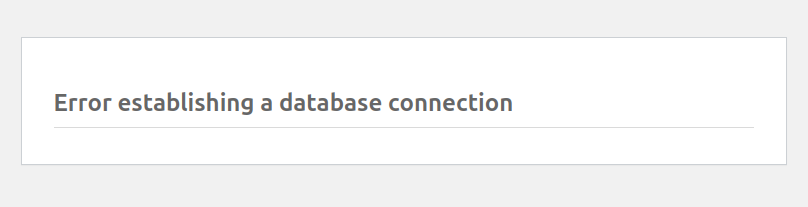

**Explicación:** aparece **«Error establishing a database connection»** (en español, *«Error al establecer una conexión con la base de datos»*). WordPress no puede leer sus datos porque MariaDB está apagado.

Ahora arranco MariaDB de nuevo y compruebo su estado:

```bash
sudo systemctl start mariadb
systemctl is-active mariadb
```

Salida:

```text
active
```

Recargo la web y vuelve a funcionar:


### Guía rápida cuando WordPress muestre ese error

1. **¿Está MariaDB en marcha?** → `systemctl is-active mariadb`. Si no, `sudo systemctl start mariadb`.
2. **¿Siguen siendo correctos el usuario y la contraseña?** → `mariadb -u wp_user -p wordpress`. Si falla, las credenciales de `wp-config.php` no coinciden con las de MariaDB.

###  Cuando WordPress muestra «Error al establecer una conexión con la base de datos», ¿qué dos cosas comprobarías y en qué orden?

**Respuesta:**

1. **Primero, si MariaDB está en marcha:** `systemctl is-active mariadb`. Es lo más sencillo y la causa más frecuente. Si responde `inactive`, se arranca con `sudo systemctl start mariadb`.
2. **Después, si el usuario y la contraseña son correctos:** `mariadb -u wp_user -p wordpress`. Si MariaDB está activo pero no puedo entrar con `wp_user`, el problema son las credenciales (`DB_USER`, `DB_PASSWORD`, `DB_NAME` en `wp-config.php`).

Se empieza por lo más simple y rápido de comprobar: si el servicio funciona. Solo si está activo se pasa a mirar las credenciales.

---

## 10. Comprobación final

```bash
systemctl is-active apache2 mariadb
php -v
ls /etc/apache2/sites-enabled/
sudo mariadb wordpress -e "SHOW TABLES;"
```


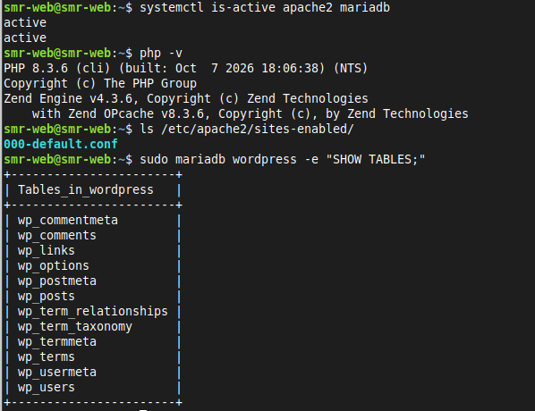

**Explicación:** Apache y MariaDB responden `active`, PHP es la 8.3.6, en `sites-enabled` solo hay `000-default.conf` (**un único sitio**) y la base `wordpress` tiene sus 12 tablas.

### Estado final del servidor

| Pieza | Programa | Estado |
|---|---|---|
| **L**inux | Ubuntu 24.04 | Instalado |
| **A**pache | Apache2 (2.4.58), con un único sitio | Funcionando |
| **M**ariaDB | MariaDB 10.11 | Funcionando, con la base `wordpress` |
| **P**HP | PHP 8.3.6 | Funcionando |
| **WordPress** | Instalado en `/var/www/html` | Funcionando y accesible desde el navegador |

### Datos de acceso (sin contraseñas)

| Dato | Valor |
|---|---|
| Dirección de la web | `http://192.168.56.17` |
| Panel de administración | `http://192.168.56.17/wp-admin` |
| Usuario administrador | `pako` |
| Contraseña | `********` (guardada en privado) |

### Snapshot

Hago una nueva **instantánea (snapshot)** de la máquina virtual con el servidor listo. Será mi punto de partida seguro para trabajar con WordPress.

---

## 11. Chuleta de comandos

| Para qué | Comando |
|---|---|
| Ver la IP del servidor | `hostname -I` |
| Conectar por SSH | `ssh smr-web@192.168.56.17` |
| Servicios activos | `systemctl is-active apache2 mariadb` |
| Versión de PHP | `php -v` |
| Desactivar sitios antiguos | `sudo a2dissite sitio1.conf sitio2.conf` |
| Activar el sitio por defecto | `sudo a2ensite 000-default.conf` |
| Probar la configuración de Apache | `sudo apache2ctl configtest` |
| Recargar / reiniciar Apache | `sudo systemctl reload apache2` / `restart apache2` |
| Sitios activos | `ls /etc/apache2/sites-enabled/` |
| Carpeta del sitio | `grep DocumentRoot /etc/apache2/sites-enabled/000-default.conf` |
| Entrar en MariaDB | `sudo mariadb` |
| Crear base de datos | `CREATE DATABASE wordpress;` |
| Crear usuario | `CREATE USER 'wp_user'@'localhost' IDENTIFIED BY '********';` |
| Dar permisos | `GRANT ALL ON wordpress.* TO 'wp_user'@'localhost';` |
| Probar el usuario | `mariadb -u wp_user -p wordpress` |
| Borrar y empezar de nuevo | `DROP DATABASE wordpress;` y `DROP USER 'wp_user'@'localhost';` |
| Descargar WordPress | `cd /tmp` y `wget https://wordpress.org/latest.tar.gz` |
| Descomprimir | `tar -xzf latest.tar.gz` |
| Copiar a Apache | `sudo rm /var/www/html/index.html` y `sudo cp -a /tmp/wordpress/. /var/www/html/` |
| Limpiar temporales | `rm -r /tmp/wordpress /tmp/latest.tar.gz` |
| Propietario | `sudo chown -R www-data:www-data /var/www/html` |
| Permisos de directorios | `sudo find /var/www/html -type d -exec chmod 755 {} \;` |
| Permisos de ficheros | `sudo find /var/www/html -type f -exec chmod 644 {} \;` |
| Ver tablas de WordPress | `sudo mariadb wordpress -e "SHOW TABLES;"` |
| Editar la configuración | `sudo nano /var/www/html/wp-config.php` |
| Comprobar sintaxis PHP | `php -l /var/www/html/wp-config.php` |
| Activar enlaces bonitos | `sudo a2enmod rewrite` y `sudo a2enconf wordpress` |
| Subir el límite de subida | `printf 'upload_max_filesize = 64M\npost_max_size = 64M\n' \| sudo tee /etc/php/8.3/apache2/conf.d/99-wordpress.ini` |
| Parar / arrancar MariaDB | `sudo systemctl stop mariadb` / `start mariadb` |

---

## 12. Conclusiones y problemas encontrados

Con esta práctica he completado el **LAMP** y he instalado **WordPress** sobre él. He aprendido que WordPress es una **aplicación web**: el servidor no necesita interfaz gráfica porque el navegador de mi ordenador dibuja las páginas, y que se trabaja por **dos puertas**: **SSH** (puerto 22) para administrar y **HTTP** (puerto 80) para usar la web. También he entendido cómo se reparten el trabajo las piezas: Apache sirve las páginas, PHP ejecuta WordPress y MariaDB guarda todo el contenido (entradas, usuarios y ajustes), en la base de datos y no en ficheros.

En seguridad, he aplicado dos ideas importantes: usar un **usuario de base de datos propio** con permisos solo sobre su base (mínimo privilegio) y usar permisos **755/644** con propietario `www-data`. Y no usar `admin` como usuario ni subir contraseñas a GitHub.

**Problemas encontrados y cómo los resolví:**

| Problema | Causa | Solución |
|---|---|---|
| `systemctl is-active apache2 mariadb` devolvía `inactive` para Apache | Apache estaba parado (tras reiniciar la máquina virtual) | `sudo systemctl start apache2` y comprobar que vuelve a `active` |
| Al activar el sitio por defecto decía `Site 000-default already enabled` | Ya lo había activado en la práctica anterior | No es un error: solo confirma que ya estaba activo |
| Aviso `AH00558` sobre el `ServerName` | Apache no tiene un nombre de servidor global | `ServerName localhost` en `conf-available/servername.conf` y `a2enconf servername` |
| Aparecía la página «Servidor de Nabil» en vez de WordPress | Seguía existiendo `/var/www/html/index.html` (tiene prioridad sobre `index.php`) o era caché del navegador | Borrar `index.html` y comprobar con `curl -I http://localhost` |
